# Chronos v1.1.1

> **Discipline = Value + Reward − Friction**  
> A 100% offline-first, keyboard-driven Rust terminal workspace (`ratatui` + `crossterm`) for monotonic deep-work timekeeping, literature & reading velocity tracking, multi-horizon circadian analytics, sustainable RPG progression, and guarded local data ownership.

![Chronos Command Deck (`[1] Home`)](assets/screenshots/01-home-command-deck.png)

---

## Table of Contents

1. [Overview & Design Philosophy](#1-overview--design-philosophy)
2. [What's New in v1.1.1 & v1.1.0](#2-whats-new-in-v111--v110)
3. [Visual Tour: All 9 Screens, Zen Mode & Headless CLI](#3-visual-tour-all-9-screens-zen-mode--headless-cli)
   - [`[1]` Home — Command Deck](#31-1-home--command-deck)
   - [`[2]` Focus — Focus Arena & Cadence Engine](#32-2-focus--focus-arena--cadence-engine)
   - [`[3]` Reading — Reading Sanctuary & Bookshelf](#33-3-reading--reading-sanctuary--bookshelf)
   - [`[Z]` Zen Mode — Pure-Black Distraction-Free Canvas](#34-z-zen-mode--pure-black-distraction-free-canvas)
   - [`[4]` Stats — Analytics Observatory (5 Lenses × 6 Horizons)](#35-4-stats--analytics-observatory-5-lenses--6-horizons)
   - [`[5]` Log — Searchable Session Ledger & Inspector](#36-5-log--searchable-session-ledger--inspector)
   - [`[6]` Trophies — Sustainable Progression & 24 Achievements](#37-6-trophies--sustainable-progression--24-achievements)
   - [`[7]` Skills — Category Studio & Goal Tracking](#38-7-skills--category-studio--goal-tracking)
   - [`[8]` Settings — Preferences, Vault Safety & 9 Themes](#39-8-settings--preferences-vault-safety--9-themes)
   - [`[9]` Guide — Built-In 14-Topic Interactive Manual](#310-9-guide--built-in-14-topic-interactive-manual)
   - [Headless CLI Mode (`report`, `mastery`, `backup`, `restore`, `export`, `doctor`)](#311-headless-cli-mode-report-mastery-backup-restore-export-doctor)
4. [Progression System: XP Math, Daily Chest, 20 Levels & 24 Trophies](#4-progression-system-xp-math-daily-chest-20-levels--24-trophies)
5. [Theme Engine & Color-Depth Adaptation (9 Built-In Palettes)](#5-theme-engine--color-depth-adaptation-9-built-in-palettes)
6. [Deep Architectural & Engineering Specification](#6-deep-architectural--engineering-specification)
   - [Layered Module Map](#61-layered-module-map)
   - [Monotonic Wall-Clock Timer, Midnight Splitting & Overlap Guard](#62-monotonic-wall-clock-timer-midnight-splitting--overlap-guard)
   - [Atomic Persistence, Schema v3 Migration & Corruption Quarantine](#63-atomic-persistence-schema-v3-migration--corruption-quarantine)
   - [In-Memory Polyphonic Singing-Bowl WAV Synthesizer](#64-in-memory-polyphonic-singing-bowl-wav-synthesizer)
   - [Waybar / Polybar Live Status-Bar Telemetry (`status.json`)](#65-waybar--polybar-live-status-bar-telemetry-statusjson)
7. [Complete Keyboard Shortcuts Reference](#7-complete-keyboard-shortcuts-reference)
8. [Installation, Building & Automated Test Suite](#8-installation-building--automated-test-suite)
9. [Configuration (`preferences.toml`), File Paths & Environment Variables](#9-configuration-preferencestoml-file-paths--environment-variables)

---

## 1. Overview & Design Philosophy

**Chronos** is a single-binary terminal application written in safe, idiomatic Rust (2021 edition, `rust-version = "1.87"`) built around a simple behavioral equation:

$$\text{Discipline} = \text{Value} + \text{Reward} - \text{Friction}$$

- **Maximize Value**: Give deep focus and long-form reading equal, first-class citizenship. Track not only minutes spent coding or researching, but also books on your shelf, page checkpoints (`start_page` → `end_page`), and real reading velocity in **pages per hour (`p/h`)**.
- **Honest, Sustainable Reward**: Earn XP, level titles (*Novice Timekeeper* → *Sovereign of Kairos*), daily quests, deterministic **Daily Chest** drops (`30–150 XP`), and 24 achievements—while enforcing a **healthy 5-hour/day XP ceiling (`18,000s`)** so rest is respected and burnout is never incentivized. Prefer a plain minimalist timer? Toggle `show_gamification = false` in Settings at any time.
- **Eliminate Friction**: Launch planned blocks from the **Quest Queue** with a single `Enter` press, switch between **9 dedicated screens (`1`–`9`)** instantaneously, cycle **9 built-in themes (`T`)** live, or drop into a **pure-black Zen Mode (`Z`)** where everything except the circular Braille ring and countdown disappears.
- **100% Local-First & Guarded Data Ownership**: Zero cloud accounts, zero telemetry, zero network requests. Every session, book, skill category, and trophy lives in human-readable JSON/TOML on your machine, protected by PID-stamped atomic writes (`write_atomically`), rolling `.bak` snapshots, conflict-aware backup restores, and guarded reset scopes requiring verbatim `RESET MY DATA` confirmation.

---

## 2. What's New in v1.1.1 & v1.1.0

### Highlights in `v1.1.1`
- **Four-State Book Lifecycle (`Have`, `Reading`, `Read`, `Abandoned`)**:
  - Press `S` on any book in `[3] Reading` to cycle its status (`Have → Reading → Read → Abandoned → Have`).
  - States also transition automatically: launching a reading session promotes a `Have` or `Abandoned` book to `Reading`, and reaching `total_pages` promotes it to `Read` (while editing `current_page` below `total_pages` returns a `Read` book to `Reading`).
  - Full backward compatibility via `#[serde(alias = ...)]`: legacy save files using `paused`, `active`, or `completed` deserialize seamlessly into `Have`, `Reading`, and `Read`.
- **Guarded Book Deletion (`D`) with History Preservation**:
  - Press `D` on the bookshelf to remove the selected book after a confirmation dialog (`ModalDialog::ReadingDeleteConfirm`).
  - Every book can be deleted (including the last remaining book on the shelf), and all historical reading sessions, logged pages, streaks, and XP remain intact in your ledger and analytics.
- **Pure-Black (`#000000`) Zen Mode & Seamless Ring Rendering**:
  - Zen Mode (`Z`) now forces a true `#000000` background (`Palette::pure_black`) across all 9 themes and color depths (`TrueColor`, `Ansi256`, `Ansi16`).
  - The circular Braille timer ring in `[2] Focus` and `[3] Reading` now paints directly onto the card surface (`p.card`) without drawing a black rectangular backdrop inside the card.
- **Dedicated Reading Timer Session Hint**:
  - The status line inside `[3] Reading` now displays the configured reading duration and how to adjust it (`35 min session (+/- to change)`) instead of displaying the Focus cadence preset name (`Harmonic`), which only applies to `[2] Focus`.

### Highlights in `v1.1.0`
- **Card-First Responsive UI Architecture**: Rebuilt every screen around adaptive rounded/double-bordered cards (`ui::card`), flexbox-style centering (`ui::center`), 1/8th-cell precision horizontal meters (`▏▎▍▌▋▊▉█`), and dynamic column fitting (`ui::fit_cols`) that scales gracefully from `1×1` up to `200×60` ultrawide terminals without dead space.
- **Sub-Cell Braille Progress Ring (`src/tui/ring.rs`)**: Circular countdown dial rendered on a `2×4` Unicode Braille dot canvas (`\u2800`–`\u28ff`) with a pulsing tip and auto-scaling 5-row block digits (`3×`, `2×`, `1×`, or single-line fallback).
- **Daily Quests & Deterministic Daily Chest**: 4 daily quests on the Command Deck plus a FNV-1a date-seeded **Daily Chest** (`Bronze`, `Silver`, `Gold`, or `150 XP Jackpot`) unlocked whenever you hit a valid Daily Focus Goal (`>= 60 min`).
- **5-Lens Analytics Observatory**: Expanded `[4] Stats` to 5 lenses (`Overview`, `Rhythm`, `Skills`, `Days`, `Review`) including Golden Hour detection, interactive heatmap day exploration, and a 14-day trailing XP level-up forecast.
- **Built-In 14-Topic Interactive Guide (`[9]` or `?`)**: Full in-app manual with keyboard chips, examples, tips, and sticky topic navigation.
- **9 Built-In Themes Including `Monochrome`**: Added pure black/white/grey `Monochrome` mode alongside 8 high-contrast dark palettes.

---

## 3. Visual Tour: All 9 Screens, Zen Mode & Headless CLI

Every screen in Chronos shares a unified 4-band frame (`src/tui/shell.rs`) when the terminal is at least `20×6`:
1. **Top Header Bar**: App badge (`◈ CHRONOS`), live active-session pill (`● FOCUS 18:42` or `❚❚ READ 24:10`, visible from any screen while a timer is active), active combined streak (`ϟ14d`, highlighted in warning amber when at risk), current level (`Lv 8`), level progress meter, and total XP (`4230 XP`).
2. **Centered Navigation Tab Strip**: Keys `1` through `9` (`Home`, `Focus`, `Reading`, `Stats`, `Log`, `Trophies`, `Skills`, `Settings`, `Guide`). Collapses non-active tabs to numbers on narrow terminals while keeping the active tab's full title visible.
3. **Main Card Workspace**: Screen-specific responsive grid of cards (`BorderType::Rounded` when unfocused, `BorderType::Double` in accent color when focused/active).
4. **Bottom Context-Aware Action Bar**: Dynamically fits `[Key] Label` chips for the current screen, or displays a `★` toast banner for 4 seconds after actions like backups, exports, or adjustments.

---

### 3.1 `[1]` Home — Command Deck

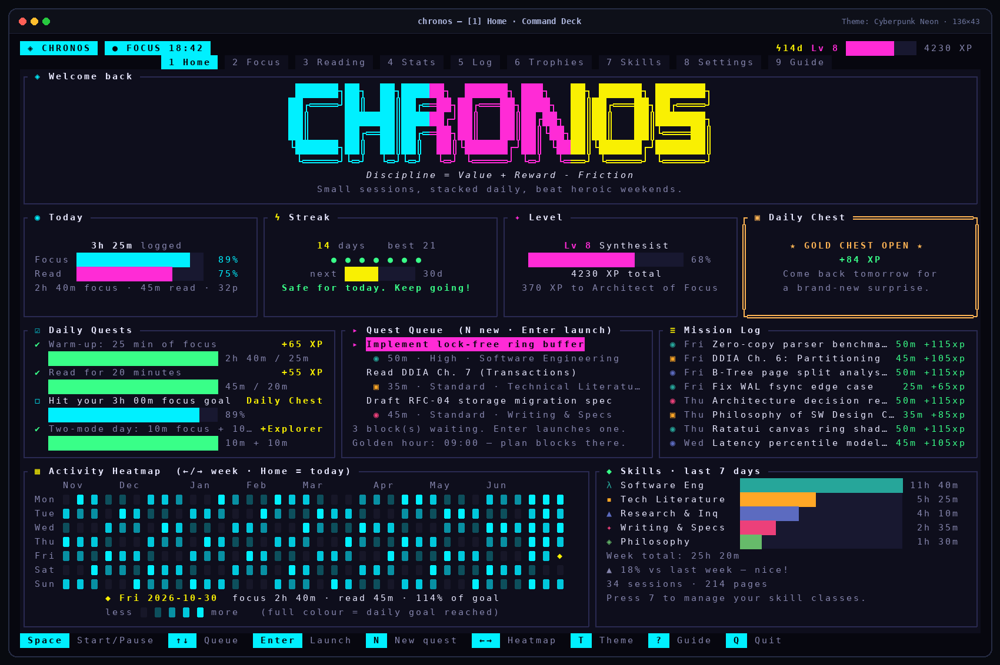

The **Command Deck** (`src/tui/views/home.rs`) uses greedy vertical section planning (`stats_h = 8`, `mid_min = 9`, `bottom_h = 12`, plus full 6-row or compact 4-row ASCII banner when vertical space allows) to answer four questions at a glance:

- **Hero Card (`◈ Welcome back`)**: Displays the 3-band gradient `CHRONOS` ASCII banner (`accent → accent2 → accent3`), the tagline *Discipline = Value + Reward - Friction*, and a daily rotating mantra from `MANTRAS` indexed by ordinal day of the year.
- **Top Stat Row (4 Equal Cards)**:
  - **`◉ Today`**: Total productive time logged today, 1/8th-cell progress meters for your Daily Focus and Daily Reading goals, and a breakdown of `focus · read · pages`.
  - **`ϟ Streak`**: Current combined streak vs. all-time best, a 7-day visual dot chain (`●` active day `>= 60s`, `◌` today pending, `○` missed day), a milestone progress bar toward the next streak tier (`3, 7, 14, 30, 60, 100, 200, 365` days), and live streak-at-risk alerts.
  - **`✦ Level`**: Current level number and title (e.g., `Lv 8 Synthesist`), percentage progress bar toward the next level, total XP, and exact XP needed for the next title.
  - **`▣ Daily Chest`**: Displays `▣ LOCKED` with a progress bar and remaining focus minutes needed until your Daily Focus Goal (`>= 60m`) is met, then flips to `★ <BRONZE|SILVER|GOLD|JACKPOT> CHEST OPEN ★` with your date-seeded bonus (`+30` to `+150 XP`).
- **Middle Action Row (3 Equal Cards)**:
  - **`☑ Daily Quests`**: Four auto-tracked daily challenges with live progress meters:
    1. *Warm-up: 25 min of focus* (`+65 XP`)
    2. *Read for 20 minutes* (`+55 XP`)
    3. *Hit your daily focus goal* (`Daily Chest`)
    4. *Two-mode day: 10m focus + 10m reading* (`+Explorer`)
  - **`▸ Quest Queue`**: Your scheduled task backlog (`PlannedBlock`). Press `N` to schedule a block (title, activity type, skill, duration, and `Low`/`Standard`/`High`/`Critical` priority), `↑`/`↓` to select, and `Enter` to launch it directly into the timer (`+20 XP` bonus upon completion). Includes an automatic hint showing your 90-day **Golden Hour**.
  - **`≡ Mission Log`**: Reverse-chronological feed of your most recent sessions with activity glyph (`◉` Focus, `▣` Reading, `☾` Break), weekday, objective, duration, and XP earned.
- **Bottom Analytics Row (`3:2` Split)**:
  - **`▦ Activity Heatmap`**: Up to 53 weeks of Monday–Sunday daily activity squares (`■` in 5-stop theme heat palette `p.heat[0..4]`, with `◆` marking the cursor-selected date). Navigate weeks with `←`/`→` and jump back to today with `Home`.
  - **`◆ Skills · last 7 days`**: Horizontal bar chart comparing 7-day time across active skill classes plus weekly total, period-over-period delta badge (`▲`/`▼ % vs last week`), session count, and pages read.

---

### 3.2 `[2]` Focus — Focus Arena & Cadence Engine

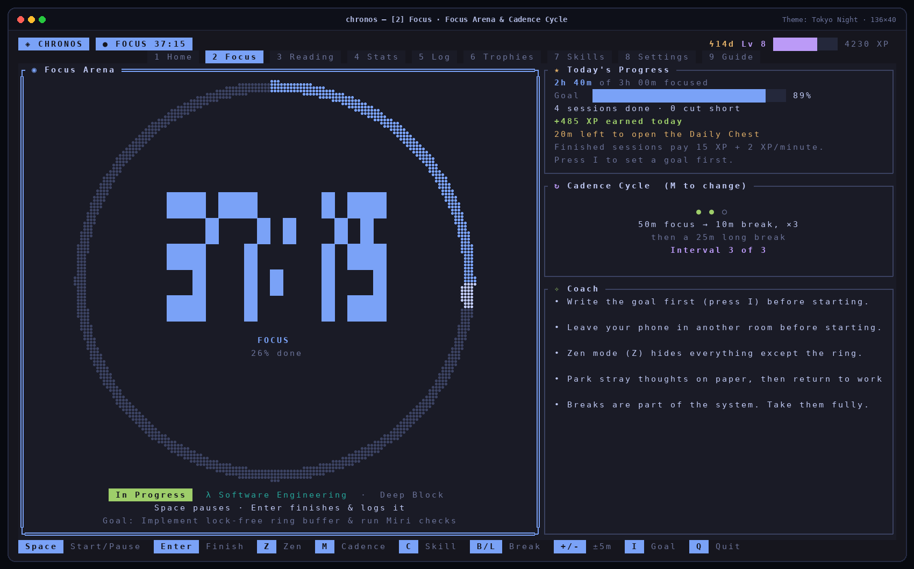

The **Focus Arena** (`src/tui/views/focus.rs`) pairs a high-precision circular timer with live progress context:

- **`◉ Focus Arena` Card**:
  - **Braille Circular Ring (`src/tui/ring.rs`)**: Computes aspect-corrected bounds (`w = cols * 2.0`, `h = rows * 4.0`) so the ring is geometrically circular in terminal character cells. Draws `radius * 8` radial steps with configurable stroke thickness and a pulsing tip (`pulse` toggling between `2.2` and `1.2` every 10 ticks when `MotionLevel != Off`).
  - **Auto-Scaling Block Digits**: Renders `MM:SS` (or `H:MM:SS`) inside the ring at `3×`, `2×`, or `1×` 5-row block scale depending on available card dimensions, alongside phase label (`FOCUS`, `SHORT BREAK`, `LONG BREAK`) and completion percentage.
  - **Live Controls**: `Space` starts/pauses/resumes; `Enter` finishes early or logs a completed phase (opening the session notes modal); `R` abandons and logs an interrupted session (if `>= 5s` elapsed) or resets; `+`/`-` adjusts target length by `±5 minutes` (`60s`..`4h`, clamped above `elapsed_seconds + 1`); `I` edits the session goal/notes; `C` cycles Focus-compatible skills; `F`/`B`/`L` switches between Focus, Short Break, and Long Break.
- **Right-Hand Context Stack**:
  - **`★ Today's Progress`**: Today's focus time vs. goal, completed vs. cut-short session counts, today's XP total, and remaining minutes to unlock the Daily Chest.
  - **`↻ Cadence Cycle`**: Visual interval dots (`● ● ○`) and schedule summary for the active cadence (`M` to cycle):
    - **Harmonic**: `25m focus → 5m short break × 4`, then `15m long break`
    - **Deep Block**: `50m focus → 10m short break × 3`, then `25m long break`
    - **Monolith**: `90m focus → 20m short break × 2`, then `40m long break`
    - **Custom**: User-defined focus (`5..240m`), short break (`1..120m`), long break (`5..180m`), and intervals (`1..12`) configured in Settings.
  - **`✧ Coach`**: Rotating actionable deep-work habits and focus reminders.

---

### 3.3 `[3]` Reading — Reading Sanctuary & Bookshelf

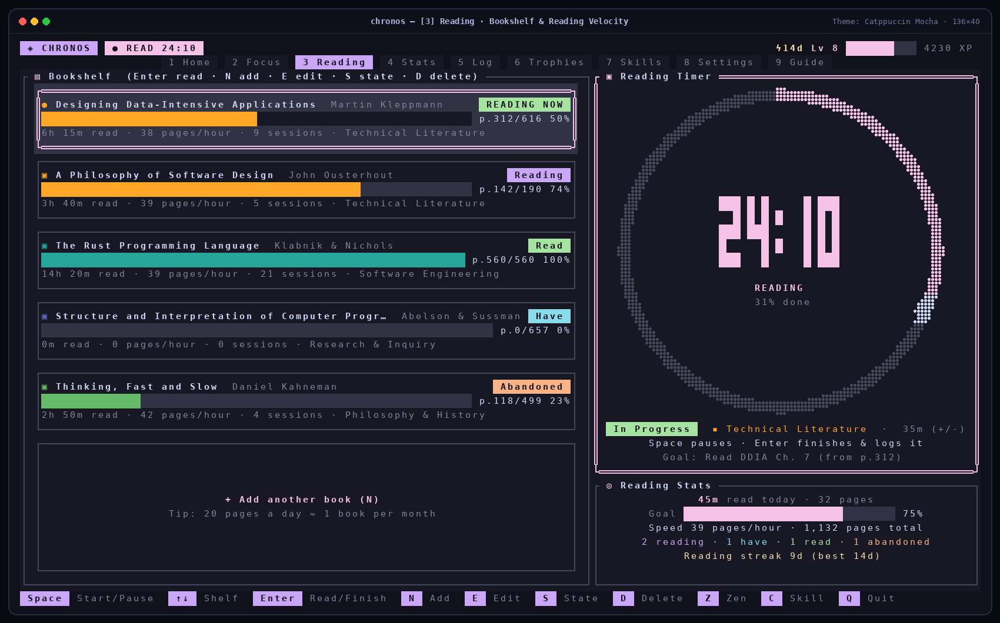

The **Reading Sanctuary** (`src/tui/views/reading.rs`, `src/domain/sanctuary.rs`) treats technical literature, monographs, papers, and essays as first-class domain entities:

- **`▤ Bookshelf` Card**:
  - Displays each `ReadingMaterial` as a self-contained progress card with double borders on the selected item and a live `READING NOW` badge when a session is actively running for that book.
  - **4 Material Kinds**: `Book / Monograph`, `Academic Paper`, `Technical Manual / RFC`, and `Essay / Long-Form Article`.
  - **4 Lifecycle States (`S` to cycle)**:
    - `Have` (owned/queued, not yet started)
    - `Reading` (currently reading)
    - `Read` (completed; jumping to `Read` sets `current_page = total_pages`)
    - `Abandoned` (set aside; preserved for honest tracking)
  - **Per-Book Telemetry**: Full-width 1/8th-cell page progress bar, `p.<current>/<total> <pct>%`, cumulative reading time, real **reading velocity (`pages/hour`)** derived from actual session page deltas (`reconcile_reading_shelf_totals`), completed session count, and assigned skill class.
  - **Active Session Guard**: Launching a book with `Enter` automatically pre-fills the timer with that book's title, author, skill category, and last recorded `current_page` as `start_page`. If another session is already running, Chronos refuses to clobber it (or resumes if it's the same book).
- **`▣ Reading Timer` & `◎ Reading Stats` Cards**:
  - Dedicated reading countdown ring (default `35m`, adjustable anytime with `+`/`-` without cycling Focus cadences) and a summary card showing today's reading time, pages read today, daily reading goal bar, overall reading speed (`pages/hour`), shelf state breakdown (`reading · have · read · abandoned`), and active/best reading streak.

---

### 3.4 `[Z]` Zen Mode — Pure-Black Distraction-Free Canvas

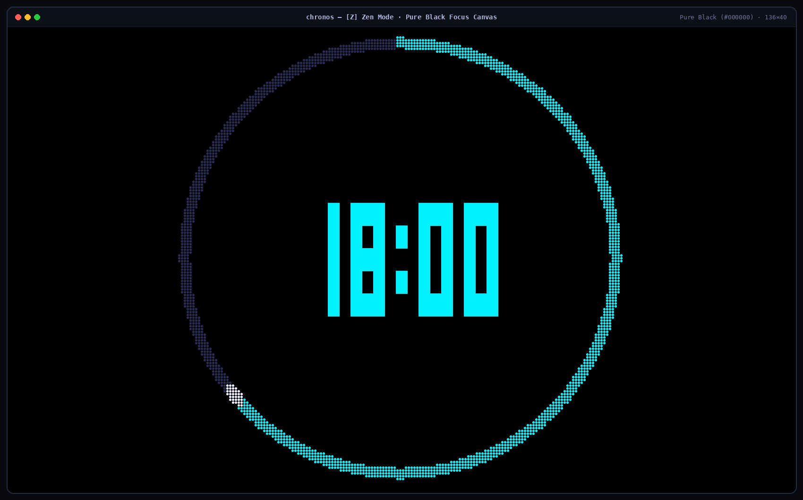

Pressing `Z` inside either `[2] Focus` or `[3] Reading` enters **Zen Mode** (`shell::render_zen`):

- Strips away the top header bar, navigation tabs, side cards, borders, and footer key chips.
- Paints every cell of the terminal viewport with pure `#000000` black (`Palette::pure_black`) regardless of active theme.
- Renders only the maximum-diameter circular Braille progress ring and 3× scaled block countdown digits in the center of the screen (`accent` for Focus, `accent2` for Reading, `good` for Breaks, `warn` when Paused).
- Press `Space` to pause/resume while staying in Zen Mode, or `Z` / `Esc` to return to the full workspace. Can be enabled automatically on session start via `zen_mode_default = true` in `preferences.toml`.

---

### 3.5 `[4]` Stats — Analytics Observatory (5 Lenses × 6 Horizons)

The **Analytics Observatory** (`src/tui/views/analytics.rs`, `src/domain/observatory.rs`) synthesizes your session ledger across **6 time horizons** (`[` / `]` to cycle: `1d Today`, `7d`, `30d`, `90d`, `1y`, `all`) and optional single-skill filtering (`C`), topped by **6 persistent KPI tiles** (`Total time`, `Daily average`, `vs. before` period delta, `Finish rate`, `Streak`, and `Pages`).

Press `Tab` (or `Shift+Tab`) to flip across **5 analytical lenses**:

#### Lens 1: `Overview` (Executive Summary, Records & Skill Mix)
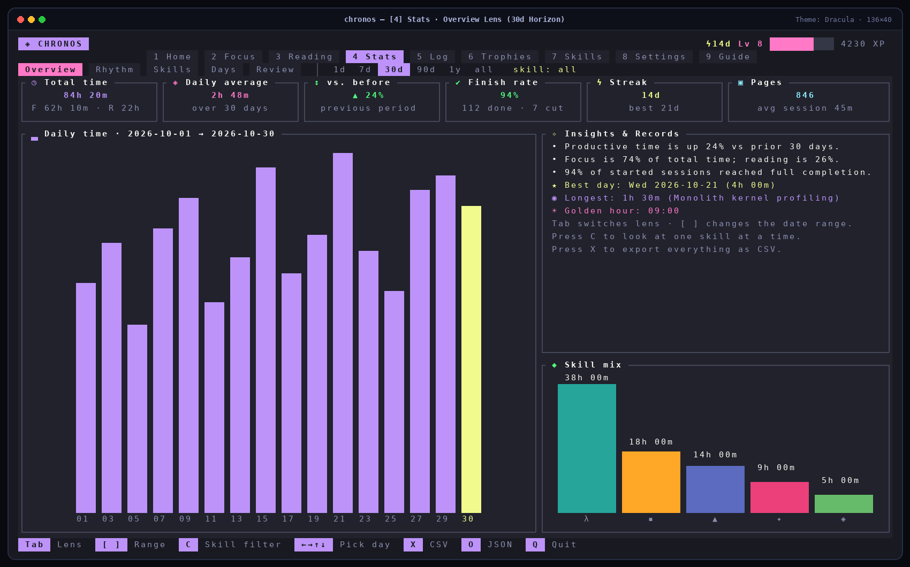

- **Daily Time Bar Chart**: Auto-bucketed vertical bar chart (`ui::vbars`) with 1/8th-cell vertical resolution (`▁▂▃▄▅▆▇█`), value labels above bars, and highlighted current period bar.
- **Insights & Personal Records**: Automated plain-language observations, peak date (`★ Best day`), longest uninterrupted session (`◉ Longest session`), and peak circadian hour (`☀ Golden hour`).
- **Skill Mix**: Vertical bar chart comparing top active skills by total hours.

#### Lens 2: `Rhythm` (24-Hour Circadian Distribution & Weekday Matrix)
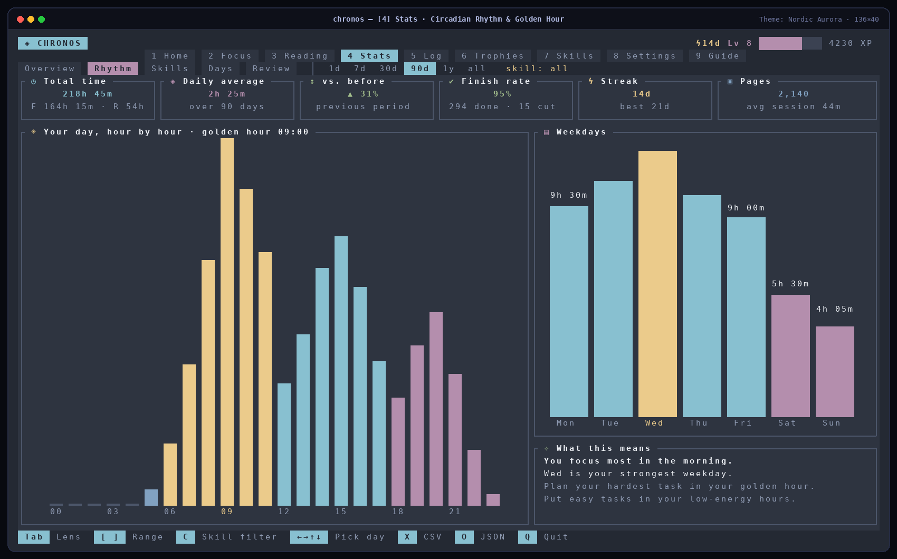

- **Hour-by-Hour Circadian Histogram (`00:00`–`23:00`)**: Attributes every session across local hours of the day, color-coded by time band (Morning `06–11` in `accent3`, Afternoon `12–17` in `accent`, Evening `18–23` in `accent2`, Night `00–05` in `info`), with your **Golden Hour** highlighted.
- **Weekdays (`Mon`–`Sun`) & Synthesis Card**: Compares cumulative time across all seven weekdays, identifies your strongest weekday, and synthesizes whether you perform best in the morning, afternoon, or evening/night.

#### Lenses 3, 4 & 5: `Skills`, `Days`, and `Review`
- **`Skills` (`CategoryMatrix`)**: Renders a full-width proportional stacked bar of all skill categories alongside individual share rows (`hours`, `% share`, `session count`) and live daily/weekly skill goal progress gauges.
- **`Days` (`DayExplorer`)**: Combines the interactive 53-week **Activity Heatmap** (`←`/`→` week, `↑`/`↓` day, `Home` today) with a day-specific inspector listing every session logged on that exact calendar date, how that day measured against your daily Focus/Reading goals, and a 24-hour bar chart for that date.
- **`Review` (`WeeklyReflection`)**: Compares the last 7 days against the prior 7 days (`synthesize_weekly_reflection`), generates tailored schedule coaching (`Coach says`), projects your weekly pace and estimated days to the next level based on trailing 14-day XP (`Forecast`), and lists your **Closest Trophies** sorted by completion percentage.

---

### 3.6 `[5]` Log — Searchable Session Ledger & Inspector

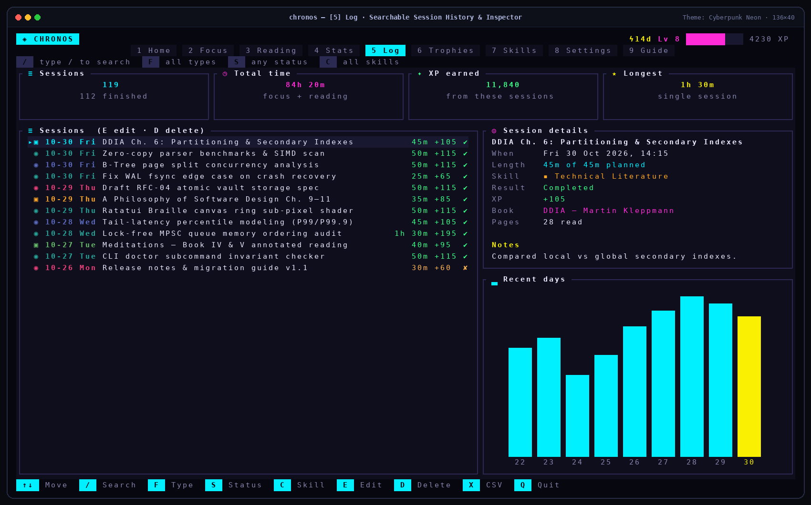

The **Session Ledger** (`src/tui/views/history.rs`) provides full auditability and non-destructive editing over your historical sessions:

- **Interactive Multi-Filter Bar**:
  - `/` — Live substring search across date keys (`YYYY-MM-DD`), session objectives, completion notes, category names, and book titles.
  - `F` — Cycle activity filter (`all types` → `Focus` → `Reading` → `Short Break` → `Long Break`).
  - `S` — Cycle completion status (`any status` → `Completed` → `Interrupted`).
  - `C` — Filter by specific skill category.
  - `Backspace` (when not typing in `/`) clears all active filters at once.
- **Dynamic Filtered KPI Tiles**: Live totals (`Sessions`, `Total time`, `XP earned`, `Longest`) recomputed instantaneously for the currently filtered subset.
- **Session Table, Details Card & Recent Days Chart**: Inspect full session metadata (start timestamp, planned vs. elapsed length, skill, completion result, XP earned, book title, pages read, and completion notes) alongside a `Recent days` bar chart highlighting the selected session's date.
- **Safe Editing (`E`) & Deletion (`D`)**:
  - Press `E` to edit a session's goal, notes, elapsed minutes (`1..240m`), skill category, pages read, or completion status. Extending a session's duration is automatically clamped against the next productive session's start time (`edit_session_record`) so historical edits can never create overlapping double-counted time, and `split_across_midnights` + `reconcile_reading_shelf_totals` + `evaluate_progression` run immediately.
  - Press `D` to delete a session with confirmation, automatically unlinking any associated planned block back to `Pending` and recalculating all reading shelf and XP totals.
  - Press `X` to export CSV or `O` / `J` to export structured JSON.

---

### 3.7 `[6]` Trophies — Sustainable Progression & 24 Achievements

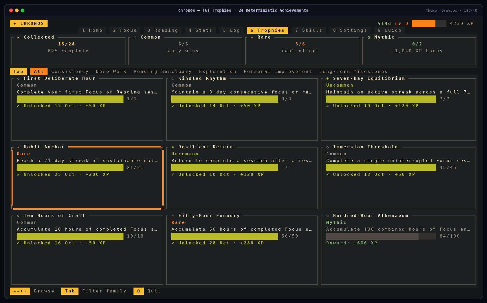

The **Trophies Hall** (`src/tui/views/trophies.rs`, `src/domain/progression.rs`) presents all **24 deterministic achievements** in a responsive 3-column card grid:

- **Top Rarity Summary Tiles**: Tracks overall completion (`Collected`), `Common`, `Rare`, and `Mythic` counts plus cumulative bonus XP earned from trophies.
- **Family Filter Strip (`Tab`)**: Filter between `All`, `Consistency`, `Deep Work`, `Reading Sanctuary`, `Exploration`, `Personal Improvement`, and `Long-Term Milestones`.
- **Idempotent Unlock Ledger**: Each trophy card shows its rarity glyph (`◇ Common`, `◈ Uncommon`, `✦ Rare`, `❂ Mythic`), requirement description, 1/8th-cell progress bar (`current / target`), unlock date, and XP bonus. Once unlocked in `ProgressionLedger.unlocked`, a trophy is permanently yours with its UTC unlock timestamp.

---

### 3.8 `[7]` Skills — Category Studio & Goal Tracking

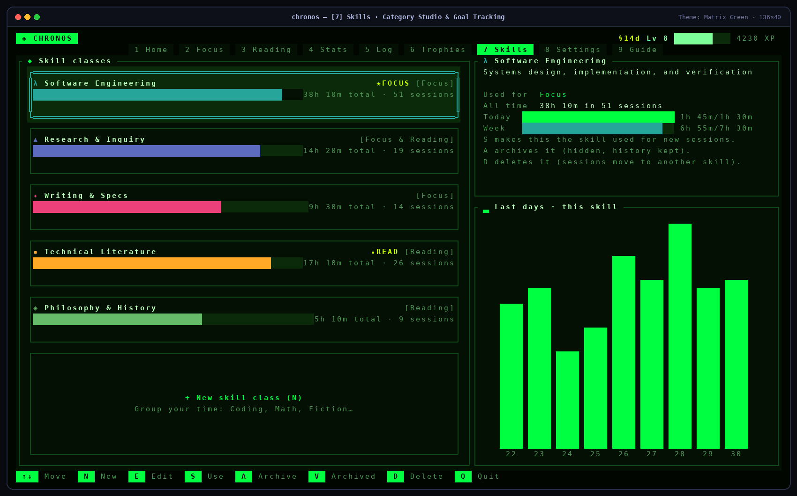

The **Category Studio** (`src/tui/views/categories.rs`, `src/domain/taxonomy.rs`) organizes where your hours go:

- **Immutable UUID-Keyed Categories**: Every skill is keyed by an immutable ID (e.g., `cat_software_eng` or generated `cat_<timestamp>_<seq>`) so renaming or recoloring a skill updates every historical session, reading item, and analytics report without breaking references.
- **WCAG 2.1 Contrast Validation**: Custom hex colors are validated against both dark (`#121619`) and light (`#FBF9F5`) reference surfaces (`validate_category_hex` requiring contrast ratio `>= 2.8:1` on both), and the in-app editor (`N` / `E`) provides 10 pre-validated semantic swatches (`Botanical Teal`, `Athenaeum Indigo`, `Terracotta Rose`, `Warm Amber`, `Mineral Sage`, `Iris Violet`, `Cerulean Sky`, `Coral Vermilion`, `Umber Bronze`, `Monolith Slate`) and 8 geometric icons (`◈`, `λ`, `◆`, `▪`, `▲`, `✦`, `❖`, `Ω`).
- **Activity Scopes & Per-Skill Goals**: Scope each skill to `FocusOnly`, `ReadingOnly`, or `Universal (Focus & Reading)`, and set optional daily (`0..720m`) and weekly (`0..5040m`) minute targets tracked both here and in `[4] Stats → Skills`.
- **Safe Archival (`A`) & Deletion Guard (`D`)**:
  - Active-session coverage invariant (`ensure_active_category_coverage`) guarantees at least one active Focus category and one active Reading category always remain available.
  - Deleting a skill that has historical sessions opens `ModalDialog::CategoryDeleteConfirm`, letting you either **Archive** it (hiding it from pickers while keeping history) or **Reassign** all linked sessions, books, and planned blocks to a replacement skill (recording `reassigned_from_category` for auditability).

---

### 3.9 `[8]` Settings — Preferences, Vault Safety & 9 Themes

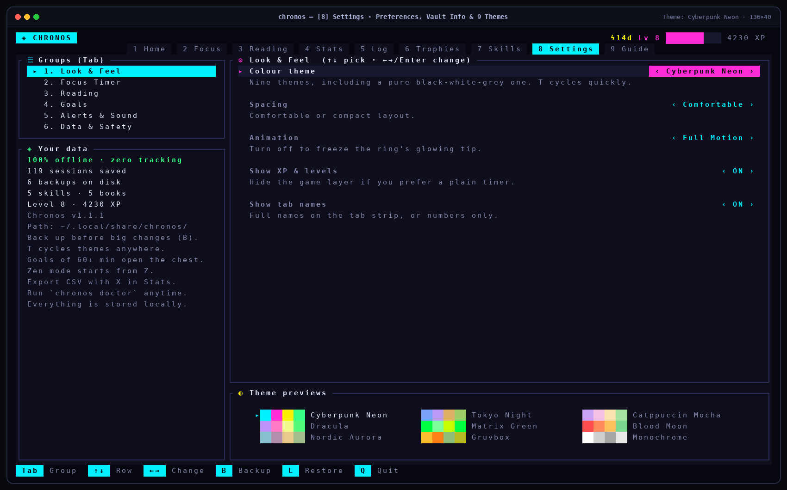

The **Settings Center** (`src/tui/views/settings.rs`) organizes all configuration and data safety operations into **6 groups** (`Tab` to switch group, `↑`/`↓` to pick row, `←`/`→` or `Enter` to adjust and persist immediately to `preferences.toml`):

1. **Look & Feel**: Colour theme (9 themes with live `Theme previews` swatch card at the bottom), Spacing (`Comfortable` / `Compact`), Animation (`Full Motion` / `Reduced / Calm` / `No Animation`), Show XP & levels (`ON` / `OFF`), Show tab names (`ON` / `OFF`).
2. **Focus Timer**: Default Rhythm (`Harmonic`, `Deep Block`, `Monolith`, `Custom`), Custom focus minutes (`5..240`, step `5`), Custom short break (`1..120`), Custom long break (`5..180`), Auto-start breaks (`ON` / `OFF`), Count cut-short sessions in totals (`ON` / `OFF`).
3. **Reading**: Default reading time (`5..240m`, step `5`), Track pages (`ON` / `OFF`), Ask for notes on completion (`ON` / `OFF`).
4. **Goals**: Daily focus goal (`0..720m`, step `15`), Weekly focus goal (`0..5040m`, step `30`), Daily reading goal (`0..720m`, step `10`), Weekly reading goal (`0..5040m`, step `30`).
5. **Alerts & Sound**: Desktop alerts via `notify-send` (`ON` / `OFF`), Sound chime (`ON` / `OFF`), Status-bar `status.json` file export (`ON` / `OFF`).
6. **Data & Safety**:
   - **Back up now (`B` or `Enter`)**: Writes a verified `BackupEnvelope` JSON snapshot to `backups/`.
   - **Restore latest backup (`L` or `Enter`)**: Validates backup schema and opens `ModalDialog::BackupRestoreConfirm` showing exact incoming vs. conflicting session/skill/book/trophy counts and letting you choose between **Merge (Keep Existing on ID Conflict)**, **Merge (Overwrite Conflicts with Backup)**, or **Replace Entire Vault**.
   - **Export CSV + JSON**: Writes both RFC-4180 CSV and structured JSON exports to `exports/`.
   - **4 Guarded Reset Scopes**:
     1. *Reset Statistical History* (clears sessions & progression, resets book counters to `0`, keeps categories/books/preferences)
     2. *Reset Achievements & Progression* (clears unlocked trophies & XP, keeps sessions/books/categories)
     3. *Reset Preferences to Defaults* (restores default `Preferences` while keeping all vault data)
     4. *Factory Reset All Application Data* (restores a clean default vault and default preferences)
     Every reset operation automatically writes a verified pre-reset backup (`chronos-backup-pre_reset-*.json`) and requires typing `RESET MY DATA` verbatim in `ModalDialog::DestructiveResetConfirm`.

---

### 3.10 `[9]` Guide — Built-In 14-Topic Interactive Manual

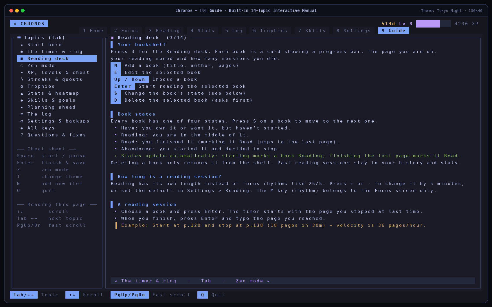

Accessible anytime via `9` or `?`, the **Interactive Guide** (`src/tui/views/guide.rs`) provides a 14-chapter plain-language manual right inside the terminal:

- **14 Topics (`Tab` or `←`/`→` to switch, `↑`/`↓`/`PgUp`/`PgDn` to scroll)**:
  1. `★ Start here`
  2. `◉ The timer & ring`
  3. `▣ Reading deck`
  4. `◌ Zen mode`
  5. `✦ XP, levels & chest`
  6. `ϟ Streaks & quests`
  7. `❂ Trophies`
  8. `▲ Stats & heatmap`
  9. `◆ Skills & goals`
  10. `▸ Planning ahead`
  11. `≡ The log`
  12. `⚙ Settings & backups`
  13. `◈ All keys`
  14. `? Questions & fixes`
- Features custom-styled section headers (`▌`), bullet points (`•`), highlighted example blocks (`┃`), pro-tips (`✧`), inline key badges, a left-hand cheat sheet, a proportional right-edge scrollbar, and a sticky previous/next topic footer bar.

---

### 3.11 Headless CLI Mode (`report`, `mastery`, `backup`, `restore`, `export`, `doctor`)

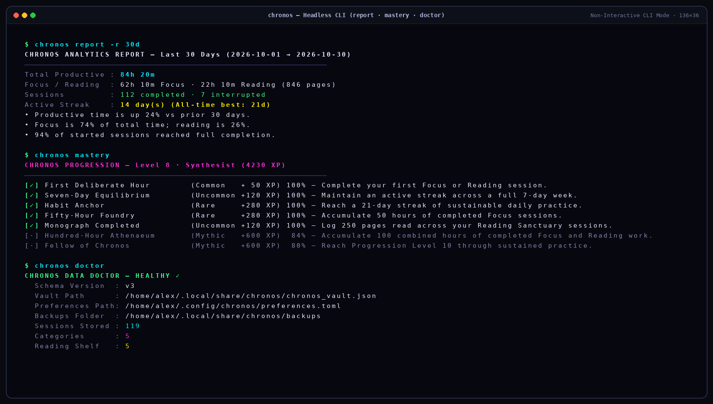

Chronos ships with a full non-interactive CLI (`src/cli.rs`, powered by `clap` v4.5) for scripting, dotfiles automation, cron backups, and quick terminal checks without launching the TUI:

```bash
# Launch the interactive TUI workspace (default when no subcommand is passed)
chronos

# Print a human-readable analytics report for any horizon (today | 7d | 30d | 90d | 1y | all)
chronos report -r 7d
chronos report -r 30d -c cat_software_eng

# Emit machine-readable JSON analytics for scripts, dashboards, or status bars
chronos report -r 30d --json

# Print current Level, Title, total XP, and progress across all 24 achievements
chronos mastery

# Create a verified backup envelope in ~/.local/share/chronos/backups/ (or custom -o path)
chronos backup
chronos backup -o ~/backups/chronos-manual.json

# Validate and restore a backup with explicit conflict resolution (merge | overwrite | replace)
chronos restore ~/backups/chronos-manual.json --mode merge
chronos restore ~/backups/chronos-manual.json --mode overwrite
chronos restore ~/backups/chronos-manual.json --mode replace

# Export session history to RFC-4180 CSV or full structured JSON
chronos export -f csv
chronos export -f json -o ~/exports/chronos-vault-export.json

# Run deep vault health & referential integrity diagnostics
chronos doctor
```

What `chronos doctor` verifies (`vault_integrity_problems` in `src/cli.rs`):
1. Full JSON serialization/deserialization and schema version (`v3`) validation.
2. Duplicate session ID detection across `vault.sessions`.
3. Orphaned category foreign-key references across `vault.sessions`, `vault.reading_shelf`, and `vault.planned_blocks`.
4. Exact mathematical conservation between each session's `day_slices` sum ($\sum \text{slice.seconds}$) and its `elapsed_seconds`.

---

## 4. Progression System: XP Math, Daily Chest, 20 Levels & 24 Trophies

Chronos implements a deterministic, replayable progression engine (`src/domain/progression.rs`) where total XP is always a pure function of your verified session history, planned blocks, categories, and idempotent achievement unlocks:

### XP Earning Formula & Healthy Daily Ceiling

$$\text{Base XP} = 2 \times \left\lfloor\frac{\text{CappedProductiveSeconds}}{60}\right\rfloor + 15 \times N_{\text{completed}} + 10 \times N_{\text{annotated}} + 20 \times N_{\text{planned}} + \left\lfloor\frac{P_{\text{read}}}{2}\right\rfloor + \text{ChestXP}$$

- **Healthy 5-Hour Daily Ceiling (`MAX_DAILY_REWARDED_SECS = 18,000s`)**: Each calendar day credits at most 5 hours (`300 minutes = 600 time-based XP`) of productive Focus + Reading toward XP. Sessions beyond 5 hours in a single day are still recorded accurately in your history and analytics, but do not inflate XP.
- **Session Completion Bonus**: `+15 XP` per completed productive session.
- **Reflective Annotation Bonus**: `+10 XP` when a completed session has both a non-empty `objective` and non-empty `completion_notes`.
- **Planned Block Execution Bonus**: `+20 XP` for each scheduled block completed from the Quest Queue.
- **Reading Page Velocity Bonus**: `+1 XP` for every `2 pages` read in completed Reading Sanctuary sessions.
- **Daily Chest (`daily_chest_xp`)**: Whenever a calendar day meets a valid Daily Focus Goal (`>= 60 minutes`), Chronos hashes the `YYYY-MM-DD` date key with 64-bit FNV-1a (`1469598103934665603` offset basis, `1099511628211` prime):
  - If `hash % 11 == 0`: **Jackpot Chest (`+150 XP`)**
  - Otherwise: `30 + ((hash >> 8) % 60)` (**`30–89 XP`**: `Bronze 30–49`, `Silver 50–74`, `Gold 75–89`).

### Complete 20-Level Progression Curve (`LEVEL_CURVE`)

| Level | Title | Cumulative XP Required | Span to Next Level |
| :---: | :--- | :---: | :---: |
| **1** | Novice Timekeeper | `0 XP` | `150 XP` |
| **2** | Apprentice of Attention | `150 XP` | `230 XP` |
| **3** | Cadence Initiate | `380 XP` | `320 XP` |
| **4** | Deliberate Practitioner | `700 XP` | `450 XP` |
| **5** | Scholar of the Quiet Hour | `1,150 XP` | `600 XP` |
| **6** | Deep Work Artisan | `1,750 XP` | `750 XP` |
| **7** | Keeper of Momentum | `2,500 XP` | `950 XP` |
| **8** | Synthesist | `3,450 XP` | `1,150 XP` |
| **9** | Architect of Focus | `4,600 XP` | `1,400 XP` |
| **10** | Fellow of the Athenaeum | `6,000 XP` | `1,700 XP` |
| **11** | Master of Intervals | `7,700 XP` | `2,000 XP` |
| **12** | Monolith Builder | `9,700 XP` | `2,300 XP` |
| **13** | Sage of Sustained Inquiry | `12,000 XP` | `2,700 XP` |
| **14** | Principal Polymath | `14,700 XP` | `3,100 XP` |
| **15** | Vanguard of Clarity | `17,800 XP` | `3,600 XP` |
| **16** | Luminary of Deep Thought | `21,400 XP` | `4,100 XP` |
| **17** | Chronos Steward | `25,500 XP` | `4,700 XP` |
| **18** | Grandmaster of Craft | `30,200 XP` | `5,300 XP` |
| **19** | Oracle of Quiet Mastery | `35,500 XP` | `6,500 XP` |
| **20** | Sovereign of Kairos | `42,000 XP` | *Max Level* |

### Complete 24-Achievement Catalog (`ACHIEVEMENT_CATALOG`)

| ID | Family | Title | Rarity & Bonus | Target | Condition |
| :--- | :--- | :--- | :--- | :---: | :--- |
| `ach_first_step` | Consistency | **First Deliberate Hour** | `◇ Common (+50 XP)` | `1 session` | Complete your first Focus or Reading session |
| `ach_streak_3` | Consistency | **Kindled Rhythm** | `◇ Common (+50 XP)` | `3 days` | Maintain a 3-day consecutive focus or reading streak |
| `ach_streak_7` | Consistency | **Seven-Day Equilibrium** | `◈ Uncommon (+120 XP)` | `7 days` | Maintain an active streak across a full 7-day week |
| `ach_streak_21` | Consistency | **Habit Anchor** | `✦ Rare (+280 XP)` | `21 days` | Reach a 21-day streak of sustainable daily practice |
| `ach_resilient_return` | Consistency | **Resilient Return** | `◈ Uncommon (+120 XP)` | `1 return` | Return to complete `>= 10m` after a rest gap of `>= 2` days |
| `ach_deep_first_block` | Deep Work | **Immersion Threshold** | `◇ Common (+50 XP)` | `45 minutes` | Complete a single uninterrupted Focus session of `>= 45m` |
| `ach_deep_hours_10` | Deep Work | **Ten Hours of Craft** | `◇ Common (+50 XP)` | `10 hours` | Accumulate 10 hours of completed Focus sessions |
| `ach_deep_hours_50` | Deep Work | **Fifty-Hour Foundry** | `✦ Rare (+280 XP)` | `50 hours` | Accumulate 50 hours of completed Focus sessions |
| `ach_deep_goal_days_5` | Deep Work | **Intentional Fulfilment** | `◈ Uncommon (+120 XP)` | `5 days` | Meet a valid Daily Focus Goal (`>= 60m`) on 5 separate days |
| `ach_reading_initiate` | Reading Sanctuary | **Sanctuary Opened** | `◇ Common (+50 XP)` | `1 session` | Complete your first dedicated Reading Sanctuary session |
| `ach_reading_streak_5` | Reading Sanctuary | **Daily Scholar** | `◈ Uncommon (+120 XP)` | `5 days` | Achieve a 5-day consecutive Reading streak |
| `ach_reading_hours_15` | Reading Sanctuary | **Fifteen Hours in Print** | `✦ Rare (+280 XP)` | `15 hours` | Accumulate 15 hours of completed Reading sessions |
| `ach_reading_pages_250` | Reading Sanctuary | **Monograph Completed** | `◈ Uncommon (+120 XP)` | `250 pages` | Log 250 pages read across Reading Sanctuary sessions |
| `ach_custom_category` | Exploration | **Taxonomy Architect** | `◇ Common (+50 XP)` | `1 category` | Create a custom skill category tailored to your workflow |
| `ach_polymath_categories` | Exploration | **Multi-Disciplinary Balance** | `◈ Uncommon (+120 XP)` | `3 categories` | Complete sessions across at least 3 distinct categories |
| `ach_dual_modality` | Exploration | **Dual Modality Day** | `◇ Common (+50 XP)` | `1 day` | Complete `>= 10m` Focus and `>= 10m` Reading on the same day |
| `ach_planned_execution_3` | Personal Improvement | **Blueprint Executed** | `◈ Uncommon (+120 XP)` | `3 blocks` | Complete 3 scheduled blocks from your Planned Queue |
| `ach_reflective_notes_5` | Personal Improvement | **Reflective Practitioner** | `◈ Uncommon (+120 XP)` | `5 sessions` | Record both an objective and completion note on 5 sessions |
| `ach_personal_best_day` | Personal Improvement | **New Personal Horizon** | `✦ Rare (+280 XP)` | `1 record` | Surpass a previous daily record (where prior record `>= 60m`) |
| `ach_both_goals_day` | Personal Improvement | **Full Daily Harmony** | `✦ Rare (+280 XP)` | `1 day` | Meet both Daily Focus (`>= 60m`) and Reading (`>= 20m`) goals |
| `ach_sessions_25` | Long-Term Milestones | **Quarter-Century of Sessions** | `◈ Uncommon (+120 XP)` | `25 sessions` | Complete 25 total Focus and Reading sessions |
| `ach_sessions_100` | Long-Term Milestones | **Centurion of Attention** | `✦ Rare (+280 XP)` | `100 sessions` | Complete 100 total Focus and Reading sessions |
| `ach_total_hours_100` | Long-Term Milestones | **Hundred-Hour Athenaeum** | `❂ Mythic (+600 XP)` | `100 hours` | Accumulate 100 combined hours of Focus and Reading work |
| `ach_level_10` | Long-Term Milestones | **Fellow of Chronos** | `❂ Mythic (+600 XP)` | `Level 10` | Reach Progression Level 10 (*Fellow of the Athenaeum*) |

---

## 5. Theme Engine & Color-Depth Adaptation (9 Built-In Palettes)

Every color in Chronos flows through `Palette` (`src/tui/theme.rs`). Press `T` on any screen to cycle through all **9 built-in themes** live:

| Theme ID (`preferences.toml`) | Display Name | Background (`bg`) | Card (`card`) | Primary (`accent`) | Secondary (`accent2`) | Tertiary (`accent3`) | Good (`good`) | Style Character |
| :--- | :--- | :---: | :---: | :---: | :---: | :---: | :---: | :--- |
| `cyberpunk_neon` *(default)* | **Cyberpunk Neon** | `#07070f` | `#0e0e1c` | `#00f0ff` | `#ff2bd6` | `#f9f002` | `#39ff88` | High-contrast electric cyan, magenta & neon yellow |
| `tokyonight_ops` | **Tokyo Night** | `#16161e` | `#1a1b26` | `#7aa2f7` | `#bb9af7` | `#e0af68` | `#9ece6a` | Calm midnight indigo, periwinkle blue & soft lavender |
| `catppuccin_mocha` | **Catppuccin Mocha** | `#11111b` | `#181825` | `#cba6f7` | `#f5c2e7` | `#f9e2af` | `#a6e3a1` | Warm pastel mauve, rosewater, peach & mint |
| `dracula_synth` | **Dracula** | `#191a21` | `#21222c` | `#bd93f9` | `#ff79c6` | `#f1fa8c` | `#50fa7b` | Classic vampire purple, neon pink & lime green |
| `matrix_phosphor` | **Matrix Green** | `#010601` | `#041004` | `#00ff41` | `#7dff9a` | `#c8ff00` | `#00ff41` | CRT phosphor emerald on deep obsidian green |
| `blood_moon` | **Blood Moon** | `#0d0505` | `#160a0a` | `#ff4d4d` | `#ff8a5c` | `#ffc15c` | `#7bd88f` | Crimson ember, terracotta orange & warm gold |
| `nordic_aurora` | **Nordic Aurora** | `#242933` | `#2e3440` | `#88c0d0` | `#b48ead` | `#ebcb8b` | `#a3be8c` | Polar slate, frost cyan, aurora violet & sage |
| `gruvbox_obsidian` | **Gruvbox** | `#151718` | `#1d2021` | `#fabd2f` | `#fe8019` | `#8ec07c` | `#b8bb26` | Retro warm amber, burnt orange & earthy olive |
| `monochrome` | **Monochrome** | `#000000` | `#080808` | `#ffffff` | `#cfcfcf` | `#a6a6a6` | `#e8e8e8` | Pure black, white & luminance-mapped greyscale |

### Automatic Terminal Color-Depth Quantization (`ColorDepth`)
- **`ColorDepth::True` (24-bit RGB)**: Default on modern terminals; emits exact `Color::Rgb(r, g, b)`.
- **`ColorDepth::Ansi256` (8-bit Indexed)**: Quantizes greyscale ramps (`r == g == b`) to the 24-step xterm greyscale ramp (`232..255`) and chromatic colors to the `6×6×6` color cube (`16 + 36*R + 6*G + B`).
- **`ColorDepth::Ansi16` (4-bit Base ANSI)**: Automatically selected when `TERM=linux` or `TERM=dumb`; maps RGB luminance and channel dominance to the 16 standard ANSI terminal colors.
- **In `Monochrome` Theme**: User category hex colors are automatically converted via Rec. 601 perceptual luminance (`L = (299*R + 587*G + 114*B) / 1000`) into a balanced greyscale value (`110..255`) so not a single chromatic pixel is ever drawn.

---

## 6. Deep Architectural & Engineering Specification

### 6.1 Layered Module Map

Chronos enforces a strict four-layer unidirectional architecture with zero circular dependencies:

```text
Chronos/
├── Cargo.toml                           # Package manifest (v1.1.1, Rust 1.87+, LTO release profile)
├── Cargo.lock                           # Deterministic dependency lockfile for reproducible builds
├── config/
│   └── chronos.default.toml             # Documented default preferences template
├── assets/
│   ├── chronos.svg                      # Scalable vector desktop icon
│   ├── chronos.desktop                  # XDG desktop entry for application launchers
│   ├── statusbar-chronos.sh             # Waybar / Polybar live JSON status reader script
│   └── screenshots/                     # High-DPI captures of all TUI screens & CLI
├── scripts/
│   └── install.sh                       # Locked release builder & XDG desktop installer/uninstaller
├── src/
│   ├── main.rs                          # Binary entrypoint: CLI routing, raw terminal lifecycle & panic hook
│   ├── lib.rs                           # Public library root exposing domain, storage, runtime, keymap, tui
│   ├── error.rs                         # Unified ChronosError & ChronosResult<T> error taxonomy
│   ├── cli.rs                           # Headless subcommands (report, mastery, backup, restore, export, doctor)
│   ├── audio.rs                         # 44.1kHz PCM singing-bowl WAV synthesizer & notify-send dispatcher
│   ├── runtime.rs                       # WorkspaceRuntime state container, route controller & modal stack
│   ├── keymap.rs                        # Modal-isolated, context-aware keyboard event router
│   ├── domain/                          # Layer 1: Pure, deterministic business logic (zero I/O or TUI deps)
│   │   ├── mod.rs
│   │   ├── models.rs                    # Entities, Preferences, CadencePreset, MaterialKind & WCAG 2.1 math
│   │   ├── clock.rs                     # Wall-clock ClockEngine, midnight splitter & overlap resolver
│   │   ├── taxonomy.rs                  # Category CRUD, contrast validator, archival & safe reassignment
│   │   ├── sanctuary.rs                 # ReadingMaterial shelf, 4-state lifecycle & velocity reconciliation
│   │   ├── planner.rs                   # Daily/weekly goal evaluator, PlannedBlock queue & weekly reflection
│   │   ├── observatory.rs               # 6-horizon analytics engine, streaks, circadian & weekday matrices
│   │   └── progression.rs               # 20-level XP curve, FNV-1a Daily Chest & 24-achievement evaluator
│   ├── storage/                         # Layer 2: Atomic persistence, migration, backups, exports & resets
│   │   ├── mod.rs
│   │   ├── repository.rs                # ChronosVault, ChronosPaths, write_atomically & rolling .bak recovery
│   │   ├── migration.rs                 # Schema v1/v2 -> v3 upgrader with .v<N>.bak preservation
│   │   ├── backup.rs                    # Versioned BackupEnvelope, conflict preview & 3 restore strategies
│   │   ├── export.rs                    # RFC-4180 CSV & structured JSON exporters
│   │   └── reset.rs                     # 4 guarded reset operations with pre-reset backup verification
│   └── tui/                             # Layer 4: Card-based Ratatui rendering engine
│       ├── mod.rs
│       ├── theme.rs                     # 9 ThemeId specs, Palette resolver & TrueColor/256/16 quantizer
│       ├── ui.rs                        # Card builder, flexbox centering, 1/8th meters, tiles & vbars chart
│       ├── ring.rs                      # 2x4 Braille canvas ring & 1x/2x/3x 5-row block digit renderer
│       ├── shell.rs                     # Top header, tab strip, footer chip bar, Zen Mode & frame router
│       ├── modals.rs                    # 12 centered modal dialogs & form field renderer
│       └── views/                       # 9 dedicated screen modules + shared per-frame Ctx
│           ├── mod.rs                   # Ctx builder, Daily Quests, Golden Hour & recent_days_card
│           ├── home.rs                  # [1] Command Deck
│           ├── focus.rs                 # [2] Focus Arena
│           ├── reading.rs               # [3] Reading Sanctuary
│           ├── analytics.rs             # [4] Stats Observatory (5 lenses)
│           ├── history.rs               # [5] Session Ledger
│           ├── trophies.rs              # [6] Trophies Hall
│           ├── categories.rs            # [7] Skill Classes Studio
│           ├── settings.rs              # [8] Settings & Themes
│           └── guide.rs                 # [9] 14-Topic Interactive Guide
└── tests/
    ├── domain_and_storage_suite.rs      # Unit & integration tests for clock, midnight split, XP, backups & resets
    └── render_and_clock_suite.rs        # Multi-viewport TUI render smoke tests (1x1..200x60) & regression suite
```

---

### 6.2 Monotonic Wall-Clock Timer, Midnight Splitting & Overlap Guard

Unlike naive tick-counting timers that drift when a laptop sleeps or a terminal emulator throttles background tabs, `ClockEngine` (`src/domain/clock.rs`) anchors all running intervals to UTC wall-clock timestamps (`DateTime<Utc>`):

1. **Drift-Free Snapshot (`ClockEngine::snapshot`)**:
   - Tracks `accumulated_elapsed_seconds` across prior run segments plus `segment_started_at_utc: Option<DateTime<Utc>>` for the currently active segment.
   - At any render frame `now_utc`, live elapsed time is `accumulated_elapsed_seconds + max(0, now_utc - segment_started_at_utc)`, clamped to `target_seconds`.
   - If the process crashes or is closed while a timer is running, `active_clock` is persisted inside `chronos_vault.json` and automatically recovered in the `Paused` state with exact elapsed time intact on next launch.
2. **Proportional Midnight Splitting (`split_across_midnights`)**:
   - If a 60-minute session starts at `23:30` local time and ends at `00:30` the next day, Chronos walks local midnight boundaries (`start_of_local_date_utc`) and partitions `elapsed_seconds` proportionally to wall-clock overlap across each calendar date (`Vec<DaySlice>`).
   - Every rounding remainder second is added to the final slice so $\sum \text{DaySlice.seconds} \equiv \text{elapsed\_seconds}$ is strictly invariant.
3. **Overlap Prevention (`resolve_session_overlap`)**:
   - Before committing any productive session (`Focus` or `Reading`), Chronos checks all existing productive sessions in `vault.sessions`.
   - If the new session's `[started_at_utc, ended_at_utc]` window overlaps an existing productive record, `started_at_utc` is advanced to the latest overlapping `ended_at_utc` and `elapsed_seconds` is trimmed accordingly (discarding the candidate if fewer than `5s` remain). Productive time can never be double-counted.

---

### 6.3 Atomic Persistence, Schema v3 Migration & Corruption Quarantine

All disk I/O in `src/storage/` is engineered to prevent data loss under power failure, disk-full errors, or manual file edits:

- **PID-Stamped Atomic Writes (`write_atomically`)**:
  - Writes payload bytes to a sibling temporary file `.{filename}.tmp.{pid}`, calls `File::sync_all()` (`fsync`), and performs an atomic POSIX `fs::rename` over the target path (cleaning up the temp file on any error).
- **Automatic Schema Migration (`migrate_raw_vault_json`)**:
  - Inspects `schema_version` on load. Legacy `v1` and `v2` vaults are automatically upgraded to `VAULT_SCHEMA_VERSION = 3` (populating default categories, reading shelf items, day slices, and category scopes where missing) after saving an untouched `.json.v<N>.bak` copy.
- **Rolling Backup & Corruption Quarantine (`load_vault`)**:
  - Every successful load updates `chronos_vault.json.bak`.
  - If `chronos_vault.json` ever contains corrupted JSON, Chronos **never** silently overwrites it with an empty vault: it quarantines the damaged file to `chronos_vault.json.corrupt-YYYYMMDD-HHMMSS`, attempts automatic recovery from `chronos_vault.json.bak`, and surfaces an on-screen notice.
- **Fault-Tolerant Preferences (`load_preferences`)**:
  - If a hand-edited `~/.config/chronos/preferences.toml` has a TOML syntax error, Chronos loads sanitized defaults in memory without overwriting your file on disk and warns you on startup.

---

### 6.4 In-Memory Polyphonic Singing-Bowl WAV Synthesizer

Chronos requires **zero external audio asset files**. When a phase completes (`src/audio.rs`):
- `synthesize_singing_bowl_wav()` generates a 1.4-second, 44,100 Hz, 16-bit mono PCM WAV buffer in memory combining three singing-bowl partials:
  - **C5** (`523.25 Hz`, amplitude `0.45`)
  - **G5** (`783.99 Hz`, amplitude `0.32`)
  - **E6** (`1318.51 Hz`, amplitude `0.23`)
  shaped by a `15ms` linear attack and `exp(-2.8 * t)` exponential decay envelope.
- Cached at `~/.cache/chronos/chronos_harmonic_chime.wav` and played asynchronously via the first available system player (`pw-play`, `paplay`, `aplay -q`, or macOS `afplay`), with a background reaper thread (`reap_in_background`) so helper processes never become zombies. If no audio daemon is installed, Chronos falls back cleanly to the terminal bell (`\x07`).

---

### 6.5 Waybar / Polybar Live Status-Bar Telemetry (`status.json`)

While a session is running or paused (and `status_bar_export = true`), Chronos writes `~/.cache/chronos/status.json` every second:

```json
{
  "status": "In Progress",
  "activity": "Focus",
  "category": "Software Engineering",
  "remaining_hms": "18:42",
  "elapsed_seconds": 678,
  "target_seconds": 1500,
  "progress_percent": 45,
  "level": 8,
  "total_xp": 4230,
  "updated_at_utc": "2026-10-30T09:11:18Z"
}
```

Use the bundled `assets/statusbar-chronos.sh` script in your Waybar config:

```json
"custom/chronos": {
  "exec": "/path/to/Chronos/assets/statusbar-chronos.sh",
  "return-type": "json",
  "interval": 1
}
```

---

## 7. Complete Keyboard Shortcuts Reference

### Global Shortcuts (Active on All Screens)

| Key | Action |
| :--- | :--- |
| `1` – `9` | Jump directly to screen: `1` Home · `2` Focus · `3` Reading · `4` Stats · `5` Log · `6` Trophies · `7` Skills · `8` Settings · `9` Guide |
| `Space` | Start, pause, or resume the active timer (auto-selects Focus on `[2]` or Reading on `[3]` when idle) |
| `+` / `=` | Add `5 minutes` (`+300s`) to the current/idle timer phase (up to `4 hours`) |
| `-` / `_` | Subtract `5 minutes` (`-300s`) from the current/idle timer phase (clamped above elapsed time) |
| `T` / `t` | Cycle through the **9 built-in color themes** immediately and save to preferences |
| `?` | Open `[9] Guide` (the 14-topic built-in manual) |
| `Shift+K` | Open the quick keyboard shortcut popup modal (`ModalDialog::ShortcutHelp`) |
| `Q` / `Esc` | Leave Zen Mode (if active) or quit Chronos (prompts `Save & quit / Pause & quit / Stay` if a session is running) |
| `Ctrl+C` | Immediate clean exit (persists active clock state to disk first) |

### Screen-Specific Shortcuts

| Screen | Key | Action |
| :--- | :--- | :--- |
| **`[1]` Home** | `↑` / `↓` or `k` / `j` | Move selection cursor in the **Quest Queue** |
| | `Enter` | Launch selected planned block into the timer (or jump to Focus Studio if queue is empty) |
| | `N` | Open **Plan a Block** modal (`PlannedBlockEditor`) |
| | `←` / `→` | Move **Activity Heatmap** cursor back/forward by 1 week (`7 days`) |
| | `Home` | Reset Activity Heatmap cursor to today |
| | `F` / `R` | Jump to `[2] Focus` or `[3] Reading` |
| **`[2]` Focus** | `Enter` | Complete current phase (or finish early) and open session notes/objective dialog |
| | `R` | Abandon active session (logs as `Interrupted` if `>= 5s` elapsed) or reset idle timer |
| | `M` | Cycle focus cadence preset (`Harmonic` → `Deep Block` → `Monolith` → `Custom`) |
| | `C` | Cycle active Focus skill category |
| | `F` / `B` / `L` | Switch phase to `Focus` / `Short Break` / `Long Break` |
| | `I` | Open session **Goal & Notes Editor** (`ObjectiveAndNotesEditor`) |
| | `Z` | Toggle pure-black **Zen Mode** |
| **`[3]` Reading** | `↑` / `↓` or `k` / `j` | Select a book on the **Bookshelf** |
| | `Enter` | Start reading the selected book (when idle) or finish & log ending page checkpoint (when active) |
| | `N` / `E` | Add a new book (`N`) or edit the selected book (`E`) |
| | `S` | Cycle selected book state (`Have → Reading → Read → Abandoned → Have`) |
| | `D` | Delete selected book from the shelf (with confirmation; preserves session history) |
| | `C` / `I` / `R` / `Z` | Cycle Reading skill (`C`), edit session goal/page (`I`), abandon/reset (`R`), or toggle Zen Mode (`Z`) |
| **`[4]` Stats** | `Tab` / `Shift+Tab` | Cycle analytical lens (`Overview` → `Rhythm` → `Skills` → `Days` → `Review`) |
| | `[` / `]` | Shorter / longer time horizon (`1d`, `7d`, `30d`, `90d`, `1y`, `all`) |
| | `C` | Cycle single-skill filter (`all` or individual category) |
| | `←`/`→` & `↑`/`↓` | Move heatmap cursor by week (`←`/`→`) or single day (`↑`/`↓`), `Home` for today |
| | `X` / `O` (`J`) | Export sessions to CSV (`X`) or full vault to structured JSON (`O` / `J`) |
| **`[5]` Log** | `↑` / `↓` or `k` / `j` | Navigate session history rows |
| | `/` | Enter live keyword search mode (`Enter` or `Esc` to lock query) |
| | `F` / `S` / `C` | Cycle filter by Activity Type (`F`), Completion Status (`S`), or Skill (`C`) |
| | `Backspace` | Clear all active search and category/status/type filters |
| | `E` / `D` | Edit selected historical session (`E`) or delete it (`D`) with full recalculation |
| | `X` / `O` (`J`) | Export CSV (`X`) or JSON (`O` / `J`) |
| **`[6]` Trophies** | `←` `→` `↑` `↓` / `hjkl` | Navigate the 3-column achievement grid |
| | `Tab` | Cycle achievement family filter (`All` + 6 families) |
| **`[7]` Skills** | `↑` / `↓` or `k` / `j` | Select skill category |
| | `N` / `E` | Create new skill (`N`) or edit selected skill (`E`) |
| | `S` | Set selected skill as default for new Focus/Reading sessions |
| | `A` / `V` | Archive/unarchive selected skill (`A`) or toggle showing archived skills (`V`) |
| | `D` | Safely delete skill (prompts to archive or reassign linked historical sessions) |
| **`[8]` Settings** | `Tab` | Cycle settings group (`Look & Feel` → `Focus Timer` → `Reading` → `Goals` → `Alerts & Sound` → `Data & Safety`) |
| | `↑` / `↓` or `k` / `j` | Select setting row within current group |
| | `←` / `→` or `Enter` | Adjust selected setting or trigger backup/restore/export/reset action |
| | `B` / `L` | Trigger immediate verified backup (`B`) or preview & restore latest backup (`L`) |
| **`[9]` Guide** | `Tab` / `Shift+Tab` / `←` `→` | Next / previous manual topic (`1`–`14`) |
| | `↑` / `↓` / `PgUp` / `PgDn` | Scroll manual content (`Home` jumps to top of topic) |

---

## 8. Installation, Building & Automated Test Suite

### Prerequisites
- **Rust `1.87+`** and **Cargo** (via [`rustup`](https://rustup.rs/) or system package manager, e.g., `sudo pacman -S rust` on Arch Linux).
- Optional runtime helpers on Linux: `notify-send` (`libnotify`) for desktop pop-up notifications, and `pw-play` / `paplay` / `aplay` / `afplay` for singing-bowl audio playback (falls back to terminal bell if absent).

### Build & Run
```bash
# Clone or extract Chronos
cd Chronos

# Build optimized release binary (LTO = thin, opt-level = 3, stripped)
cargo build --release --locked

# Launch the interactive TUI
./target/release/chronos
```

### Desktop & Local Bin Installation (`scripts/install.sh`)
```bash
# Builds release binary and installs to:
#   ~/.local/bin/chronos
#   ~/.local/share/applications/chronos.desktop
#   ~/.local/share/icons/hicolor/scalable/apps/chronos.svg
./scripts/install.sh

# Uninstall binary and desktop assets (preserves your data in ~/.local/share/chronos)
./scripts/install.sh --uninstall
```

### Run the Automated Test Suite
Chronos includes two comprehensive integration and regression suites (`tests/domain_and_storage_suite.rs` and `tests/render_and_clock_suite.rs`) covering wall-clock timekeeping, midnight splitting, overlap trimming, WCAG contrast validation, category deletion reassignment, reading velocity reconciliation, 4-state book transitions, FNV-1a Daily Chest stability, backup/restore conflict resolution, guarded resets, and panic-free rendering across all 9 routes and all 12 modals from `1×1` to `200×60` viewports:

```bash
cargo test
```

---

## 9. Configuration (`preferences.toml`), File Paths & Environment Variables

### Default XDG Storage Locations (`ChronosPaths::resolve`)

| Resource | Default Path (Linux / XDG) | Purpose |
| :--- | :--- | :--- |
| **Preferences File** | `~/.config/chronos/preferences.toml` | User theme, cadence, reading, goal, sound & safety settings |
| **Preferences Backup** | `~/.config/chronos/preferences.toml.bak` | Automatic rolling backup of prior TOML configuration |
| **Primary Data Vault** | `~/.local/share/chronos/chronos_vault.json` | Authoritative JSON store (sessions, books, skills, queue, XP, clock) |
| **Rolling Vault Backup** | `~/.local/share/chronos/chronos_vault.json.bak` | Automatic rolling backup updated on every clean vault load |
| **Backups Directory** | `~/.local/share/chronos/backups/` | Timestamped manual & pre-reset `BackupEnvelope` JSON archives |
| **Exports Directory** | `~/.local/share/chronos/exports/` | Generated `chronos-sessions-*.csv` and `chronos-export-*.json` files |
| **Live Status JSON** | `~/.cache/chronos/status.json` | 1Hz live timer telemetry for Waybar / Polybar / tmux status bars |
| **Synthesized Chime** | `~/.cache/chronos/chronos_harmonic_chime.wav` | Cached 44.1kHz 16-bit PCM polyphonic singing-bowl chord |

### Environment Variable Overrides

| Variable | Supported Values | Description |
| :--- | :--- | :--- |
| `CHRONOS_VAULT_PATH` | `/custom/path/vault.json` | Override the location of `chronos_vault.json` (backups & exports follow its parent folder) |
| `CHRONOS_CONFIG_PATH` | `/custom/path/preferences.toml` | Override the location of `preferences.toml` |
| `CHRONOS_COLOR_MODE` | `truecolor` \| `256` \| `16` | Force 24-bit RGB, 256-color indexed, or 16-color ANSI palette quantization |

### Default `preferences.toml` Reference

```toml
[appearance]
theme = "cyberpunk_neon"         # cyberpunk_neon | tokyonight_ops | catppuccin_mocha | dracula_synth | matrix_phosphor | blood_moon | nordic_aurora | gruvbox_obsidian | monochrome
density = "comfortable"          # comfortable | compact
motion = "full"                  # full | reduced | off
show_gamification = true         # enables XP, levels, daily quests, daily chest, and trophies
show_navigation_labels = true    # expand navigation tab names when terminal width permits

[focus]
active_cadence = "harmonic"      # harmonic (25/5/15 x4) | deep_block (50/10/25 x3) | monolith (90/20/40 x2) | custom
custom_focus_minutes = 40
custom_short_break_minutes = 8
custom_long_break_minutes = 20
custom_intervals = 3
default_category_id = "cat_software_eng"
auto_start_breaks = false
auto_start_focus = false
zen_mode_default = false
count_interrupted_in_totals = true

[reading]
default_duration_minutes = 35
default_category_id = "cat_tech_reading"
track_pages_read = true
prompt_notes_on_complete = true

[goals]
daily_focus_minutes = 180        # 3 hours/day default (>= 60m unlocks Daily Chest)
weekly_focus_minutes = 900       # 15 hours/week default
daily_reading_minutes = 60       # 1 hour/day default
weekly_reading_minutes = 300     # 5 hours/week default

[notifications]
desktop_notifications = true
sound_enabled = true
sound_preset = "singing_bowl"    # singing_bowl | harmonic_chime | marimba_pulse | silent
status_bar_export = true         # writes live ~/.cache/chronos/status.json for Waybar/Polybar

[safety]
confirm_quit_active_session = true
confirm_mode_or_route_abort = true
auto_backup_before_reset = true
```

---

## License

Released under the [MIT License](LICENSE).
